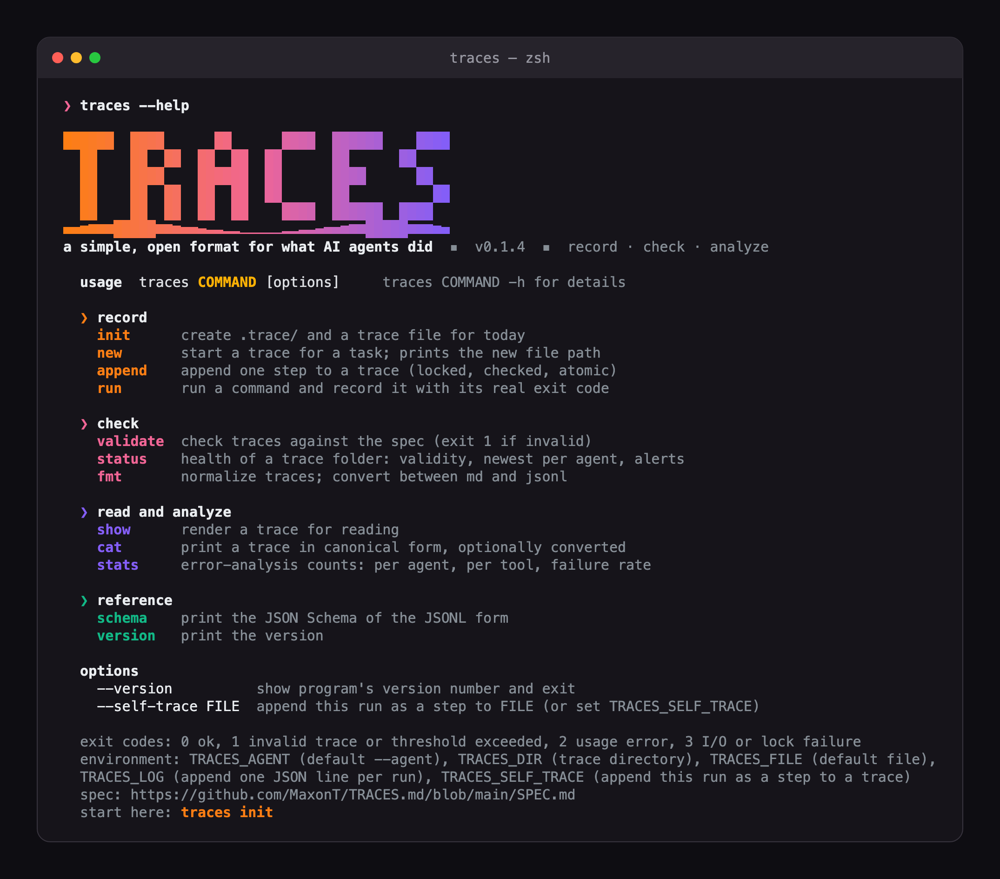
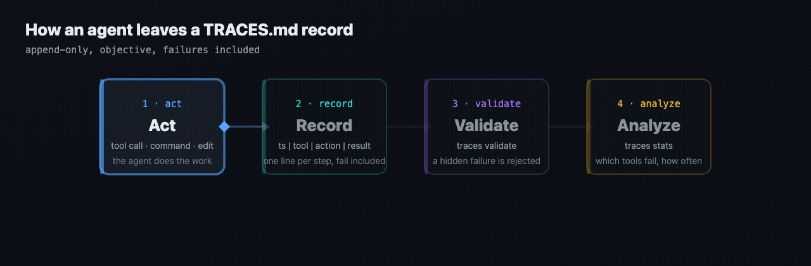

<p align="center"></p>

# TRACES.md

[](LICENSE)
[](https://www.python.org/)
[](#)
[](https://github.com/MaxonT/TRACES.md/actions/workflows/ci.yml)
[](SPEC.md)
[](https://github.com/MaxonT/TRACES.md/stargazers)

[中文](README.zh.md) · [Website](https://maxont.github.io/TRACES.md/) · [Spec](SPEC.md)

[TRACES.md](https://maxont.github.io/TRACES.md/) is a simple, open format for recording what AI agents did.
AGENTS.md, but for what agents did.

Think of TRACES.md as a **flight recorder for agents**: a dedicated, predictable place where every tool call, command and result is written down, objectively, failures included, so errors can be analyzed and agents can improve. `AGENTS.md` tells an agent how to behave; TRACES.md records what it actually did.

> **Note.** A trace is one plain, append-only file per task, one line per operation, each saying when, which tool, what it did, and how it ended. The record is **objective** (no reasoning, no story) and **honest** (failures are recorded). You cannot improve what you cannot replay.

If this is the file you wish every agent wrote, please **star the repo**. It is how other agents and people find it.

<p align="center"></p>

## Install

**Give it to your AI** (any agent that can run shell commands):

```
Read https://maxont.github.io/TRACES.md/install and install traces for me.
```

**Terminal shortcut** (never edits your shell config; add `--dry-run` to preview):

```sh
curl -fsSL https://maxont.github.io/TRACES.md/install.sh | bash
```

Python 3.9+, standard library only. Or `docker run --rm ghcr.io/maxont/traces --help`.

## The format at a glance

Below is a minimal example of a TRACES.md file, `.trace/2026-10-12-claude-code-fix-date-parser.md`:

```
task: Fix the failing date parser test
agent: claude-code
started: 2026-10-12T09:14:02-05:00
spec: traces/0.1.0

2026-10-12T09:14:31-05:00 | shell: python -m pytest tests/test_dates.py | run the date tests | fail: exit 1, 1 failed, 11 passed
2026-10-12T09:15:02-05:00 | edit: src/dates.py | change the parse format string to %Y-%m-%d | ok: 1 line changed
2026-10-12T09:15:20-05:00 | shell: python -m pytest tests/test_dates.py | run the date tests | ok: exit 0, 12 passed
```

Every step is `ts | tool | action | result`, result is `ok`, `fail` or `partial` plus a factual detail.
The same trace exists as JSONL (with a [JSON Schema](schema/trace.schema.json)), and `traces fmt` converts
between the two without loss. `traces validate` rejects a trace that hides a failure: an `ok` next to a
non-zero exit code, or a retry whose failure was never recorded.

<p align="center"></p>

[Interactive player](https://maxont.github.io/TRACES.md/assets/how-it-works.html)

## Quick use

```sh
traces init --agent claude-code --task "fix the date parser"   # .trace/ + today's file
export TRACES_FILE=.trace/<printed file>
traces run -- python -m pytest                                 # runs it, records the real exit code
traces append -t "edit: src/dates.py" -a "fix the format string" -s ok -d "1 line changed"
traces validate                                                # exit 1 if invalid or dishonest
traces stats                                                   # per agent, per tool, failure rate
```

### Recording from agent hooks

If you write traces from an agent's tool hook, register the failure event too. Many hook systems
fire their "after tool" event only when a call succeeds. In Claude Code, `PostToolUse` never sees a
failed call; that arrives as `PostToolUseFailure`. A hook on the success event alone writes a trace
that looks clean while every failure is missing, which breaks rule R1 and leaves `traces stats`
nothing to analyze. Check your tool's hook docs for its failure event, then make a command fail on
purpose and confirm a `fail` step appears.

## Standing on the shoulders of

| Project | How it shaped TRACES.md |
|---|---|
| [](https://github.com/agentsmd/agents.md) | Same shape and adoption model: one plain Markdown convention any agent can follow with no SDK. [SPEC.md](SPEC.md) section 1 opens with it: AGENTS.md tells an agent how to behave, TRACES.md tells it how to leave a record. The README, site title and description follow the agents.md wording ("a simple, open format for ..."). |

TRACES.md is an independent project, not affiliated with the projects above.

## Website

This repository also includes the website, hosted at [https://maxont.github.io/TRACES.md/](https://maxont.github.io/TRACES.md/) (GitHub Pages from `docs/`), that explains the project's goals in a simple way and features some examples. It is plain HTML, so there is nothing to build: open `docs/index.html`.

## About

TRACES.md — a simple, open format for recording what AI agents did. It came out of running several coding agents (Cursor, Trae, Kiro, Claude Code, Codex) on the same repositories, and is maintained as an open format that benefits anyone running agents, regardless of which one. This repository writes its own traces in [`.trace/`](.trace), failures included. See [SPEC.md](SPEC.md) and [north_star.md](north_star.md).

MIT licensed. Tests: `python3 -m unittest discover -s tests`.
