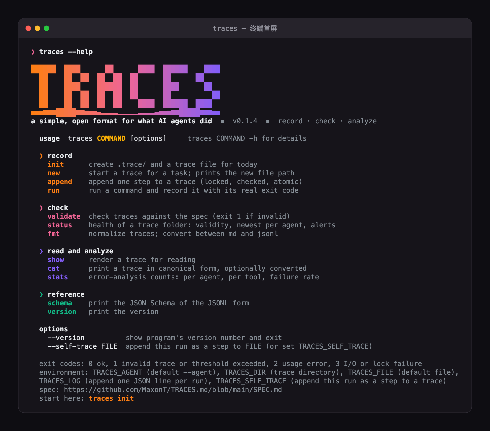

<p align="center"></p>

# TRACES.md

[](LICENSE)
[](https://www.python.org/)
[](#)
[](https://github.com/MaxonT/TRACES.md/actions/workflows/ci.yml)
[](SPEC.md)
[](https://github.com/MaxonT/TRACES.md/stargazers)

[English](README.md) · [网站](https://maxont.github.io/TRACES.md/) · [规范 SPEC.md](SPEC.md)

[TRACES.md](https://maxont.github.io/TRACES.md/) 是一个简单、开放的格式，用来记录 AI agent 做了什么。
就像 AGENTS.md，只不过记录的是 agent 做了什么。

可以把 TRACES.md 看作 **agent 的飞行记录仪**：一个专用、可预期的地方，把每一次工具调用、命令和结果客观地写下来，失败也不例外，这样才能做错误分析，agent 才能自我优化。`AGENTS.md` 告诉 agent 该怎么做事；TRACES.md 记录它实际做了什么。

> **说明。** 一份 trace 就是每个任务一个纯文本、只追加的文件，每个操作一行，写明时间、用了什么工具、做了什么、结果如何。记录必须**客观**（不写理由，不写叙述），也必须**诚实**（失败的步骤一定要记）。无法回放的东西，就无法改进。

如果你也希望每个 agent 都写这样的文件，请给仓库点个 **star**，这是别人找到它的方式。

<p align="center"></p>

## 安装

**交给你的 AI**（任何能执行 shell 命令的 agent）：

```
Read https://maxont.github.io/TRACES.md/install and install traces for me.
```

**终端快捷方式**（不会修改你的 shell 配置；加 `--dry-run` 可只预览）：

```sh
curl -fsSL https://maxont.github.io/TRACES.md/install.sh | bash
```

Python 3.9+，只用标准库。也可以用容器：`docker run --rm ghcr.io/maxont/traces --help`。

## 格式一览

下面是一个最小的 TRACES.md 文件示例，`.trace/2026-10-12-claude-code-fix-date-parser.md`：

```
task: Fix the failing date parser test
agent: claude-code
started: 2026-10-12T09:14:02-05:00
spec: traces/0.1.0

2026-10-12T09:14:31-05:00 | shell: python -m pytest tests/test_dates.py | run the date tests | fail: exit 1, 1 failed, 11 passed
2026-10-12T09:15:02-05:00 | edit: src/dates.py | change the parse format string to %Y-%m-%d | ok: 1 line changed
2026-10-12T09:15:20-05:00 | shell: python -m pytest tests/test_dates.py | run the date tests | ok: exit 0, 12 passed
```

每一步是 `ts | tool | action | result`，result 为 `ok`、`fail` 或 `partial`，后面跟一句事实性的说明。
同一份 trace 也有 JSONL 形式（带 [JSON Schema](schema/trace.schema.json)），`traces fmt` 可以无损互转。
`traces validate` 会拒绝藏起失败的 trace：`ok` 旁边却写着非零退出码，或者重试了却没记录过那次失败。

<p align="center"></p>

[交互播放器](https://maxont.github.io/TRACES.md/assets/how-it-works.zh.html)

## 快速使用

```sh
traces init --agent claude-code --task "fix the date parser"   # 创建 .trace/ 和今天的文件
export TRACES_FILE=.trace/<打印出的文件>
traces run -- python -m pytest                                 # 执行并记录真实退出码
traces append -t "edit: src/dates.py" -a "fix the format string" -s ok -d "1 line changed"
traces validate                                                # 无效或不诚实则退出码 1
traces stats                                                   # 按 agent、按工具统计失败率
```

### 从 agent 的 hook 记录

如果你用 agent 的工具 hook 来写 trace，记得把失败事件也注册上。很多 hook 系统的"工具调用后"事件只在调用成功时触发。
在 Claude Code 里，`PostToolUse` 看不到失败的调用，失败走的是 `PostToolUseFailure`。只挂成功事件的 hook 会写出一份
看起来很干净、但所有失败都不见了的 trace，这违反规则 R1，`traces stats` 也就没有东西可分析。先查你所用工具的 hook
文档找到失败事件，再故意让一条命令失败，确认 trace 里出现了 `fail` 步骤。

## 站在巨人的肩膀上

| 项目 | 它如何塑造了 TRACES.md |
|---|---|
| [](https://github.com/agentsmd/agents.md) | 同样的形态和推广方式：一个任何 agent 都能遵守、不需要 SDK 的纯 Markdown 约定。[SPEC.md](SPEC.md) 第 1 节就从它讲起：AGENTS.md 告诉 agent 怎么做事，TRACES.md 告诉 agent 怎么留下记录。README、网站标题和描述都沿用 agents.md 的说法（"a simple, open format for ..."）。 |

TRACES.md 是独立项目，与上面的项目没有隶属关系。

## 网站

本仓库同时包含网站，托管在 [https://maxont.github.io/TRACES.md/](https://maxont.github.io/TRACES.md/)（GitHub Pages，源目录 `docs/`），用简单的方式讲清项目目标并给出示例。它是纯 HTML，无需构建：直接打开 `docs/index.html`。

## 关于

TRACES.md：一个简单、开放的、用来记录 AI agent 做了什么的格式。它来自在同一批仓库上同时使用多个编程 agent（Cursor、Trae、Kiro、Claude Code、Codex）的实际工作，作为开放格式维护，对任何使用 agent 的人都适用，不绑定某一个 agent。本仓库也在 [`.trace/`](.trace) 里记录自己的 trace，包括失败。详见 [SPEC.md](SPEC.md)（英文）和 [north_star.md](north_star.md)。

MIT 许可。测试：`python3 -m unittest discover -s tests`。
